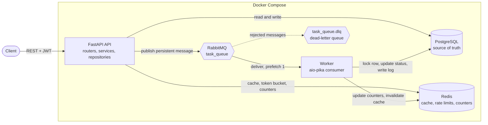
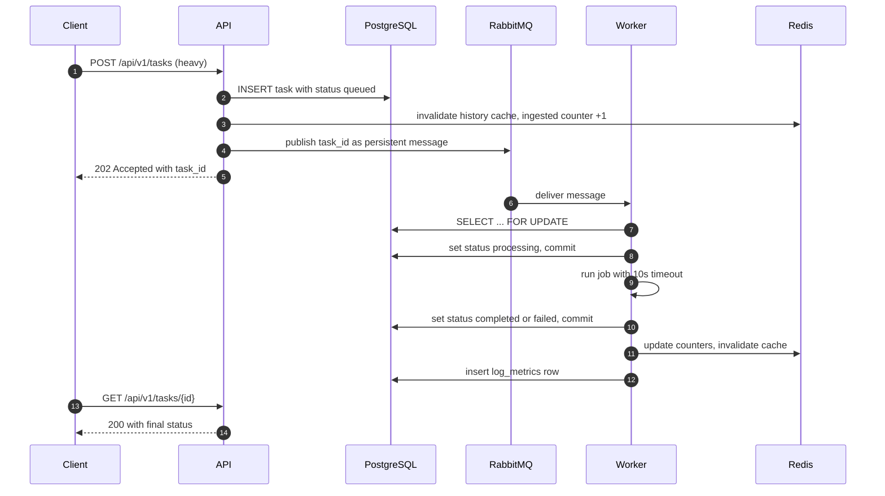
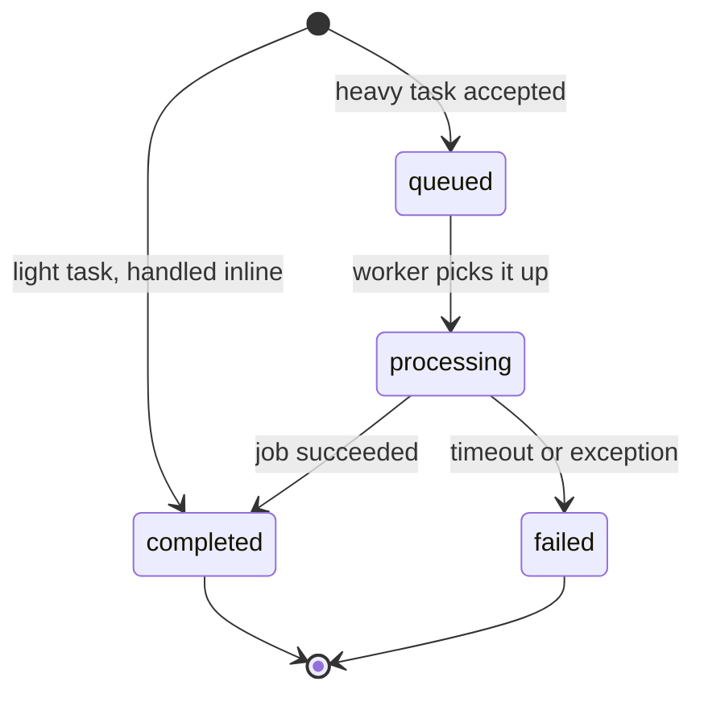
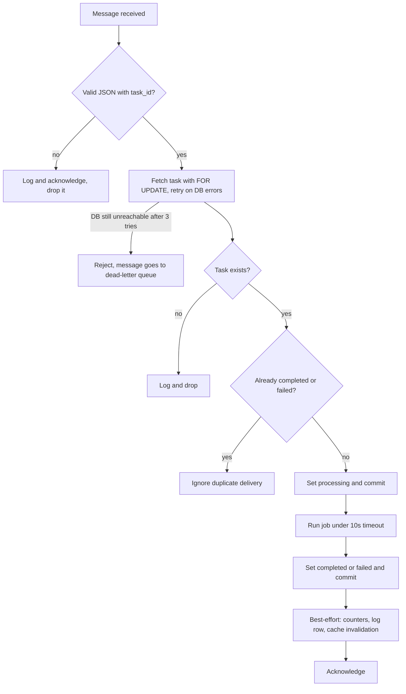
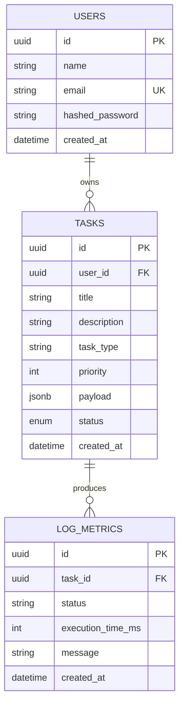

<h1 align="center">TaskVortex</h1>

<p align="center">
  An asynchronous task-orchestration backend: a REST API that accepts work, a message queue that buffers it,
  and a worker that processes it, built around the failure modes that make queue-based systems hard.
</p>

<p align="center">
  
  
  
  
  
  
</p>

<p align="center">
  
</p>


---

## Table of contents

- [Overview](#overview)
- [Features](#features)
- [Architecture](#architecture)
- [How it works](#how-it-works)
- [Data model](#data-model)
- [Engineering decisions and tradeoffs](#engineering-decisions-and-tradeoffs)
- [Challenges and what I learned](#challenges-and-what-i-learned)
- [Tech stack](#tech-stack)
- [API reference](#api-reference)
- [Getting started](#getting-started)
- [Testing](#testing)
- [Project structure](#project-structure)
- [Known limitations and roadmap](#known-limitations-and-roadmap)

---

## Overview

Many real backends can't do their work inside a request. Report generation, scraping and data extraction take too long, can fail halfway, and must survive restarts. TaskVortex is a compact implementation of that pattern:

1. A client submits a task over REST.
2. **Light** tasks complete inline. **Heavy** tasks are persisted, queued on RabbitMQ, and acknowledged immediately with `202 Accepted`.
3. A separate **worker** process consumes the queue, runs the job under a timeout, and records the outcome.
4. The client polls `GET /tasks/{id}` for status, or browses its filtered, paginated history.

> **Scope note:** the job the worker runs is a simulated 5-second workload (`asyncio.sleep`). The project is about the *orchestration around the job*: delivery guarantees, idempotency, failure handling, caching, rate limiting and observability. Swapping in real work means replacing one function.

## Features

- **Async end to end:** FastAPI, SQLAlchemy 2.0 async (asyncpg), aio-pika and redis-py asyncio.
- **Reliable queueing:** durable queue, persistent messages, a dead-letter queue, and an idempotent consumer that tolerates redelivery.
- **Safe failure handling:** job errors and timeouts become recorded `FAILED` tasks. Bookkeeping failures can never change a finished task's status.
- **JWT authentication** with bcrypt hashing, per-user data isolation, and protection against user enumeration.
- **Redis-backed history cache** with filters (status, title search, date range), pagination and invalidation on every write.
- **Token-bucket rate limiter** per client IP, with state in Redis.
- **Operational metrics:** tasks ingested, in flight, completed, failed, success rate and average execution time.
- **Structured JSON logging** with a per-request trace ID and non-blocking queue-based log handling.
- **One-command setup:** Docker Compose runs the API, worker, Postgres, Redis and RabbitMQ with healthchecks and automatic migrations.
- **Tested:** an async pytest suite covering the API, the worker's failure paths and the rate limiter.

## Architecture



The code follows a layered design, so each layer has a single job and can be tested on its own:

| Layer | Responsibility |
|---|---|
| **Routers** (`api/`) | HTTP concerns only: parse, authenticate, shape the response |
| **Services** (`services/`) | Business rules and orchestration (create task, cache, publish) |
| **Repositories** (`repository/`) | All SQL and Redis access, so no query appears in business logic |
| **Models and schemas** | SQLAlchemy tables vs. Pydantic request/response contracts |
| **Core and middlewares** | Config, security, logging, rate limiting, RabbitMQ and Redis plumbing |

## How it works

### Lifecycle of a heavy task



### Task states



### What the worker does with each message



The key ordering: **the task's final status is committed to Postgres before any best-effort bookkeeping**. Postgres is the source of truth, and everything after that is allowed to fail without corrupting it.

### Rate limiting

Each client IP gets a token bucket (capacity and refill rate are configurable). A request consumes one token. Tokens refill continuously with elapsed time, capped at capacity. Bucket state lives in a Redis hash with a TTL, so idle clients expire automatically. Exhausted buckets receive `429`.

### Caching

`GET /tasks/history` responses are cached in Redis for 5 minutes under a key built from the user ID and every query parameter (status, search, dates, page, limit). Any write that could change a user's history (task creation, update, or the worker finishing a task) invalidates that user's cached pages.

## Data model



- **UUIDv7 primary keys:** time-ordered, so inserts stay index-friendly, and IDs aren't guessable like sequential integers.
- **Composite index on `(user_id, created_at)`:** matches the history query (filter by user, newest first).
- **`JSONB` payload:** tasks of different types carry different inputs without a schema change.
- **`log_metrics`:** a durable audit row per processed task, kept separately from the fast Redis counters.

## Engineering decisions and tradeoffs

| Decision | Alternative considered | Why this, and what it costs |
|---|---|---|
| **RabbitMQ** with a separate worker process | FastAPI `BackgroundTasks`, Celery | `BackgroundTasks` dies with the API process and can't scale independently. A real broker gives durability, redelivery and a dead-letter queue. The cost is more infrastructure and handling at-least-once delivery myself. |
| **At-least-once delivery + idempotent consumer** | Trying for exactly-once | Exactly-once is not achievable across a network boundary. Instead the worker takes a row lock (`SELECT ... FOR UPDATE`) and skips tasks already `COMPLETED` or `FAILED`, so a redelivered message is harmless. |
| **`prefetch=1`** | Higher prefetch | Fair dispatch: a worker holds one message at a time, so a slow task can't hide queued work behind it. Costs some throughput per worker, fixed by running more workers. |
| **Postgres is the source of truth; Redis is derived data** | Treating counters or cache as authoritative | Redis can be flushed or fail without losing task state. The cost is that Redis metrics are approximate and best-effort. |
| **Commit final status first, bookkeeping after** | One big transaction/try block | A Redis outage must not turn a successfully finished task into `FAILED`. The cost is that metrics can occasionally miss an event, which is acceptable for monitoring data. |
| **Dead-letter queue** for infrastructure failures | Silent drop, or infinite requeue | A dropped message loses work. An infinite requeue loop hammers a dead database. The DLQ parks the message for inspection and replay. |
| **Cache with invalidate-on-write plus a 5-minute TTL** | TTL only | Users see their own new tasks immediately, and the TTL is a safety net. The cost is invalidation logic scattered across write paths (centralized in one helper). |
| **Token bucket** | Fixed-window counter | Allows short bursts while enforcing an average rate, and avoids the boundary-doubling problem of fixed windows. |
| **`404` for other users' tasks** (not `403`) | `403 Forbidden` | Doesn't reveal that a task ID exists. Combined with UUIDs, IDs can't be probed. |
| **Layered architecture** (router, service, repository) | Logic inside route handlers | Keeps HTTP, business rules and SQL separate and testable. Costs more files for a small codebase. |
| **Queue-based JSON logging** (`QueueHandler` + `QueueListener`) | Writing directly to stdout from the handler | Log I/O happens on a background thread, so a slow log sink can't block the event loop. |
| **Migrations run on API startup** | Separate migration job | Fresh clone and `docker compose up` just works. Only the API migrates, so there is no race with the worker. A real deployment would use a dedicated migration step. |

## Challenges and what I learned

**1. A finished task could be marked failed.**
My first worker kept the job, the Redis counters and the log write inside one `try`. If Redis hiccupped *after* the task had been committed as `COMPLETED`, the catch-all handler flipped it to `FAILED`. I restructured the flow into three stages: run the job, commit the outcome, then do best-effort bookkeeping. The same refactor fixed a lazy-load error in async SQLAlchemy, where reading an expired ORM attribute after a rollback raises `MissingGreenlet`. IDs are now captured before any commit.

**2. "Retry" that silently dropped messages.**
I re-raised database errors in the consumer, assuming RabbitMQ would redeliver. It doesn't: `message.process()` rejects without requeueing, so the message was discarded and the task stayed `QUEUED` forever. I added a dead-letter exchange and queue. Then I learned that RabbitMQ refuses to redeclare an existing queue with different arguments (`PRECONDITION_FAILED`), so the old queue had to be deleted once. Both API and worker now declare the topology through one shared helper so they can never disagree.

**3. Duplicate deliveries.**
Brokers deliver at-least-once, so the worker must be safe to run twice on the same message. The row lock plus the terminal-status check makes redelivery harmless. I also documented the remaining gap (see limitations) instead of pretending it doesn't exist.

**4. Blocking the event loop.**
bcrypt is deliberately slow, and calling it directly in an async handler stalls every other request. Hashing and verification now run in a worker thread. While there, I closed a timing leak: logging in with an unknown email used to return faster than a wrong password, revealing which emails are registered. Login now always runs a bcrypt comparison (against a dummy hash when the user doesn't exist).

**5. Testing an async stack with global state.**
Making the suite reliable took more than writing assertions. Redis and the DB engine are module-level singletons, so pytest-asyncio needed session-scoped event loops. Each test runs inside a transaction that is rolled back (using savepoints, so the app's own `commit()` calls don't escape it). Redis uses a separate logical database that is flushed per test. And the test schema is rebuilt on every run, after a stale integer-ID schema from earlier development caused confusing UUID type errors.

**6. Smaller bugs that were worth fixing.**
FastAPI matched `/tasks/history` as `/tasks/{task_id}` until I fixed the route order. Timezone-aware `start_date` filters crashed against naive timestamp columns, so inputs are normalised to naive UTC. `PATCH` with `"title": null` slipped past `exclude_unset` and would have violated a `NOT NULL` constraint, so it is rejected with `422`. Passwords over bcrypt's 72-byte limit are rejected up front.

## Tech stack

| Area | Technology |
|---|---|
| API | FastAPI, Pydantic v2, Uvicorn |
| Database | PostgreSQL 16, SQLAlchemy 2.0 (async, asyncpg), Alembic |
| Cache and counters | Redis 7 |
| Messaging | RabbitMQ 3.13, aio-pika, tenacity (retries) |
| Auth and security | JWT (python-jose), bcrypt |
| Packaging | Docker (multi-stage image), Docker Compose with healthchecks |
| Testing | pytest, pytest-asyncio, httpx |

## API reference

Interactive docs are served at `http://localhost:8000/docs`. Base path: `/api/v1`.

| Method | Path | Auth | Description |
|---|---|:---:|---|
| `POST` | `/users/signup` | | Register a user |
| `POST` | `/users/login` | | Exchange email and password for a JWT (OAuth2 password form) |
| `POST` | `/tasks` | ✓ | Create a task. `201` if `complexity=light`, `202` if `heavy` |
| `GET` | `/tasks/{task_id}` | ✓ | Get one of your tasks (`404` if missing or not yours) |
| `GET` | `/tasks/history` | ✓ | List your tasks. Filters: `status`, `search_query`, `start_date`, `end_date`. Pagination: `page`, `limit` (max 100) |
| `PATCH` | `/tasks/{task_id}` | ✓ | Update `title`, `description` or `priority` |
| `GET` | `/metrics/health` | | Ingested, in-flight, completed and failed counts, success rate, average execution time |
| `GET` | `/health` | | Liveness check (exempt from rate limiting) |

**Try it:**

```bash
# 1. Register and log in
curl -X POST http://localhost:8000/api/v1/users/signup \
  -H "Content-Type: application/json" \
  -d '{"name":"Ada","email":"ada@example.com","password":"correct-horse-battery"}'

curl -X POST http://localhost:8000/api/v1/users/login \
  -d "username=ada@example.com&password=correct-horse-battery"
# copy the access_token from the response
export TOKEN="<access_token>"

# 2. Submit a heavy task (returns 202 and a task_id immediately)
curl -X POST http://localhost:8000/api/v1/tasks \
  -H "Authorization: Bearer $TOKEN" -H "Content-Type: application/json" \
  -d '{"title":"Quarterly report","task_type":"report_generation","complexity":"heavy","priority":3,"payload":{"quarter":"Q3"}}'

# 3. Poll it: queued -> processing -> completed (about 5 seconds)
curl http://localhost:8000/api/v1/tasks/<task_id> -H "Authorization: Bearer $TOKEN"

# 4. See system metrics
curl http://localhost:8000/api/v1/metrics/health
```

Validation errors use a consistent shape: `{"success": false, "error_type": "ValidationError", "details": [{"field", "issue", "rejected_value"}]}`.

## Getting started

**Prerequisites:** Docker and Docker Compose.

```bash
git clone https://github.com/<your-username>/taskvortex.git
cd taskvortex

cp .env.example .env
cp .env.development.example .env.development
# optional: set a real SECRET_KEY
#   python -c "import secrets; print(secrets.token_hex(32))"

docker compose up --build
```

Database migrations run automatically when the API container starts.

| Service | URL |
|---|---|
| API and Swagger docs | http://localhost:8000/docs |
| RabbitMQ management UI | http://localhost:15672 (credentials from `.env`) |

**Useful commands**

```bash
docker compose up -d --build api worker   # rebuild only the app containers after code changes
docker compose logs -f api worker         # follow structured logs
docker compose down                       # stop (data is kept; add -v to wipe volumes)
```

**Configuration** (`.env.development`)

| Variable | Purpose |
|---|---|
| `DATABASE_URL`, `REDIS_URL`, `RABBITMQ_URL` | Connection strings |
| `SECRET_KEY`, `ALGORITHM`, `ACCESS_TOKEN_EXPIRE_MINUTES` | JWT settings |
| `RATE_LIMIT_CAPACITY`, `RATE_LIMIT_REFILL_RATE`, `RATE_LIMIT_TTL` | Token bucket size, tokens per second, idle expiry |

## Testing

The suite covers authentication flows, task creation (light and heavy, with the broker mocked), ownership isolation between users, history filtering, pagination and cache invalidation, `PATCH` validation, the token bucket and `429` behaviour, and the worker's paths: success, job exception, timeout, duplicate delivery, malformed message, unknown task, and bookkeeping failure.

```bash
docker compose up -d db redis
docker compose exec db psql -U <POSTGRES_USER> -d <POSTGRES_DB> -c "CREATE DATABASE taskvortex_test;"

python -m venv venv && source venv/bin/activate     # Windows: venv\Scripts\activate
pip install -r requirements.txt -r requirements-dev.txt

# set TEST_DATABASE_URL in .env.development to postgresql+asyncpg://.../taskvortex_test (host: localhost)
pytest
```

Test isolation: each test runs in a rolled-back transaction, the schema is rebuilt at the start of every run, Redis uses logical database 1 (flushed per test), and a guard refuses to run against any database whose name doesn't contain `test`.

## Project structure

```
.
├── app/
│   ├── main.py                 # app setup, lifespan, middleware, error handler
│   ├── worker.py               # RabbitMQ consumer
│   ├── api/
│   │   ├── health.py
│   │   └── v1/                 # tasks.py, users.py, metrics.py
│   ├── services/               # task_service, user_service, metrics_service, message_publisher
│   ├── repository/             # task, user, metrics, metrics_cache, rate_limiter repositories
│   ├── models/                 # SQLAlchemy models: user, task, log_metrics
│   ├── schemas/                # Pydantic request/response models
│   ├── middlewares/            # logging (trace IDs), rate limiter
│   └── core/                   # config, database, redis, rabbitmq, security, auth, logging, cache
├── alembic/                    # database migrations
├── tests/                      # pytest suite
├── Dockerfile                  # multi-stage build
└── docker-compose.yml          # api, worker, postgres, redis, rabbitmq
```

## Known limitations and roadmap

I'd rather document the gaps than hide them. These are the known weaknesses and how I would address each:

| Limitation | Impact | Planned fix |
|---|---|---|
| **Dual write:** the task is committed to Postgres, then published to RabbitMQ | A crash between the two leaves a task stuck in `QUEUED` | Transactional outbox, or a sweeper that republishes old `QUEUED` tasks |
| **No lease on `PROCESSING` tasks** | Two workers holding the same message can both run it | Add a lease or heartbeat timestamp so crashed work can be told apart from active work |
| **Rate limiter is read-modify-write** | Concurrent requests from one IP can briefly exceed the limit. It keys on the direct client IP, not `X-Forwarded-For` | Atomic Redis Lua script, and trusted-proxy header handling |
| **Cache invalidation uses `SCAN`** | Cost grows with keyspace size | Per-user version number in the cache key, so invalidation is a single `INCR` |
| **Trace ID isn't propagated to the worker** | API and worker logs for one task can't be correlated automatically | Put the trace ID in the message headers |
| **No retry with delay or DLQ replay tooling** | Dead-lettered messages need manual handling | Delayed retry queue and a replay command |
| **Shallow health check** | `/health` doesn't probe Postgres, Redis or RabbitMQ | Add readiness checks per dependency |
| **Simulated job** | The worker sleeps instead of doing real work | Pluggable handlers per `task_type` |

---
